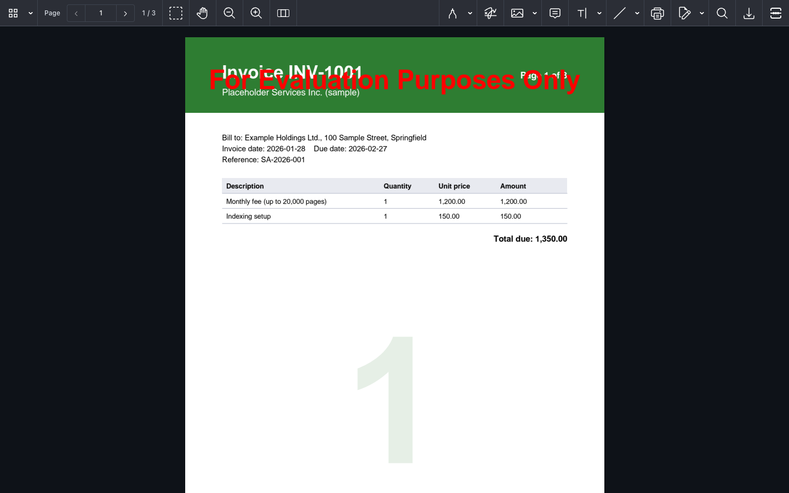
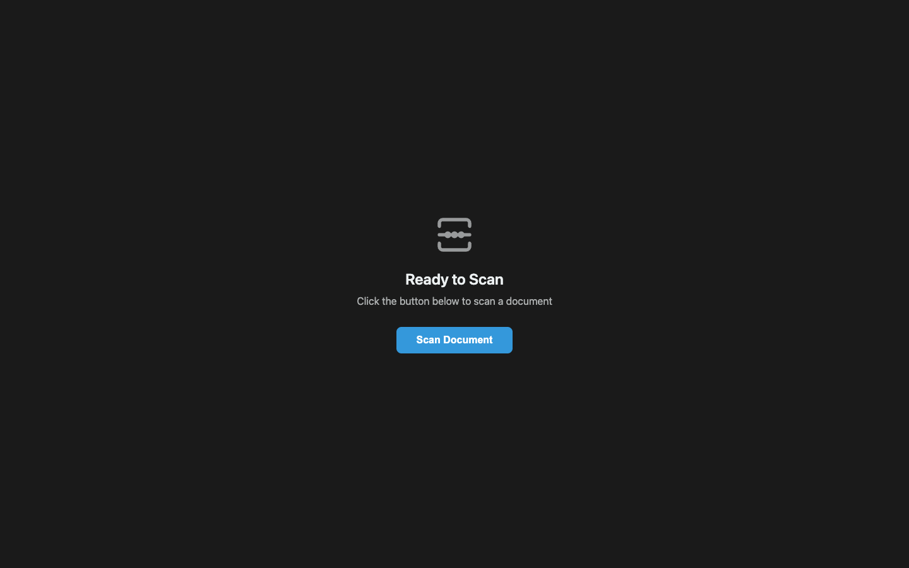

# Nutrient TWAIN Scanning

A Nutrient.io demo that scans paper documents from a TWAIN scanner through a web page and opens the searchable PDF in the Nutrient Web SDK viewer.



*The web client, not a live scan. The screenshot was taken on macOS, where TWAIN is not available: the `/api/scan` response was replaced by a fictitious sample PDF so the client could load it the way it loads a scan. The viewer runs in evaluation mode, hence the watermark.*

1. **Scan request.** The web client calls `POST /api/scan` on a small ASP.NET Core service. Browsers cannot talk to TWAIN drivers, so this service runs on the Windows machine the scanner is attached to.
2. **Acquisition.** The service opens the TWAIN source dialog with GdPicture.API and acquires pages from the feeder at 200 DPI until it is empty.
   - The scan stops if the driver sends no page for 120 seconds or fails six times in a row.
3. **PDF and OCR.** Each page is added to a PDF 2.0 document. When the OCR resources are found, `OcrPage` adds an English text layer, so the PDF is searchable.
4. **Progress.** The service streams Server-Sent Events (`init`, `scanning`, `ocr`, `saving`, `reading`, then `complete` or `error`). The client shows them in a progress bar.
5. **Viewing.** The last event carries the PDF as base64. The client opens it in the Nutrient Web SDK viewer and adds a scan button to the toolbar for the next scan.

## Prerequisites

- Windows x64 with a TWAIN scanner and its TWAIN driver. TWAIN acquisition is Windows-only: the service is built for `win-x64`. It also builds on macOS and Linux, but it cannot scan there.
- .NET SDK 10
- Node.js 20.19 or later and npm (Vite 7)
- GdPicture OCR resources (`eng.traineddata`), for example the `Redist\OCR` folder installed by the GdPicture.NET 14 setup. Without them, scans are saved without a text layer.
- Internet access in the browser: the Web SDK is loaded from the Nutrient CDN, so no SDK files are stored in this repository.

## Environment variables

All variables are optional. Copy `.env.example` to `.env` to set them. `start.ps1` loads `.env` for the service, and Vite reads the `VITE_*` values from the same file. Keys are only read from environment variables or `appsettings.json`, never from code.

| Variable | Purpose | Default |
|---|---|---|
| `GDPICTURE_LICENSE_KEY` | GdPicture.API license key used by the TWAIN service | empty = evaluation mode |
| `GDPICTURE_OCR_RESOURCES_PATH` | Folder that holds the OCR resources | `C:\GdPicture.NET 14\Redist\OCR` |
| `VITE_NUTRIENT_WEB_LICENSE_KEY` | Nutrient Web SDK license key, built into the client | empty = evaluation mode |
| `VITE_TWAIN_API_URL` | URL of the TWAIN service, as seen from the browser | `http://localhost:5000` |

In evaluation mode, the scanned PDF carries an evaluation mark and the viewer shows a watermark.

## Build and run

Run these in PowerShell on the Windows machine with the scanner.

```powershell
Copy-Item .env.example .env
```

```powershell
.\start.ps1
```

The script starts the TWAIN service on <http://localhost:5000> as a background job, starts the client on <http://localhost:6001> and opens the browser. Press Ctrl+C to stop both.

To start them by hand, use two terminals. Set the variables you need in the first one, for example:

```powershell
$env:GDPICTURE_LICENSE_KEY = "your-key"
```

```powershell
cd gdp-process\dotnet-twain\dotnet-twain
```

```powershell
dotnet run
```

In the second terminal:

```powershell
cd websdk-client
```

```powershell
npm install
```

```powershell
npm run dev
```

`npm run build` writes a static build to `websdk-client/dist`. The `VITE_*` values are read at build time.

## Using the app

1. Open <http://localhost:6001> and click **Scan Document**.

   

2. Pick the scanner in the TWAIN source dialog. The dialog opens on the machine that runs the service. Some drivers also show their own window.
3. Put the pages in the feeder. The progress bar shows each scanned page, OCR and saving.
4. The PDF opens in the viewer. To scan again, click the scan button at the right end of the toolbar. The new scan replaces the open document.

The service asks the driver for 200 DPI, RGB pixel type with a bit depth of 1, auto feed and auto scan; the driver may adjust these. OCR runs at 150 DPI. These settings are in `gdp-process/dotnet-twain/dotnet-twain/Program.cs`.

## API

| Method and path | Description |
|---|---|
| `GET /` | Health check text |
| `POST /api/scan` | Starts a scan and returns a `text/event-stream`. Progress events are `{ message, stage, current, total }`. The last event is `{ success: true, message, base64, fileName, stage: "complete" }` or `{ success: false, message, stage: "error" }` |

Each scan is written to a temporary file that is deleted once it has been sent.

## Limits

- This is a single-user setup: the TWAIN session runs inside the service, on the machine with the scanner.
- CORS allows any origin and there is no authentication. Restrict both before you run the service anywhere other than a test machine.
- If the build or run fails with `Can not find GdPicture.NET.14.filters.arm64.dll`, keep `<RuntimeIdentifier>win-x64</RuntimeIdentifier>` in `dotnet-twain.csproj`, then run `dotnet clean` and `dotnet build`.

The web client started from a Nutrient Web SDK example and keeps its license in `websdk-client/LICENSE`.
